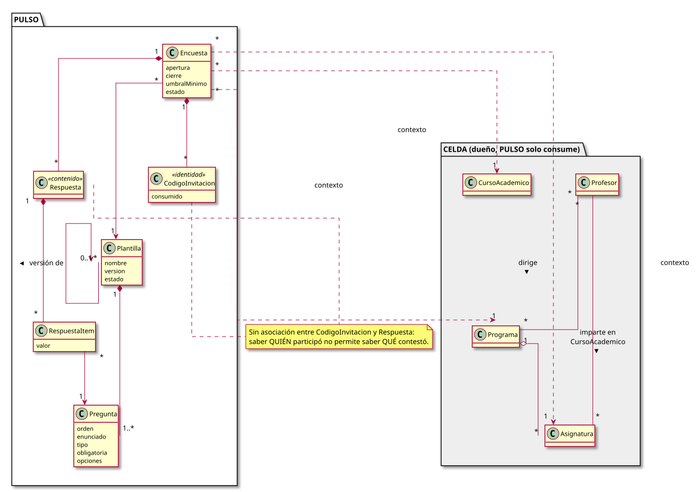

# pyPULSO - Plataforma Unificada de Levantamiento y Seguimiento de Opiniones

<div align=right>

<sub>[**RUP:**](RUP/README.md) [Modelo del dominio](RUP/00-modelo-del-dominio/README.md) / [Actores y casos de uso](RUP/01-requisitos/01-actores-casos-uso/README.md) / [Análisis: anonimato](RUP/02-analisis/anonimato.md) / [Diseño](RUP/03-diseño/README.md)<br>**[Decisiones](docs/DECISIONES.md)** · Satélite del [ecosistema CELDA](https://github.com/mmasias/_ECOSISTEMA_CELDA/blob/main/docs/PULSO/README.md)</sub>

</div>

<div align=center>

|
|-:
|<sub>[Código fuente](RUP/00-modelo-del-dominio/modeloDominio.puml)</sub>

</div>

## ¿Por qué?

La opinión del alumnado sobre la docencia se recoge hoy con formularios genéricos desconectados del catálogo académico. Cada respuesta hay que cruzarla a mano con la asignatura, el profesor y el curso académico, normalmente en una hoja de cálculo.

## ¿Qué?

Un gestor de encuestas docentes construido sobre el catálogo de [CELDA](https://github.com/mmasias/pyCelda): cada encuesta nace vinculada a un programa, una asignatura y un curso académico. Las respuestas son anónimas y llegan ya contextualizadas.

| Problema | Mecanismo |
|---|---|
| Datos sin contexto | La encuesta referencia programa, asignatura y curso de CELDA, validados al crearla |
| Anonimato frente a "un alumno, una respuesta" | Código de invitación de un solo uso, sin ningún vínculo almacenado con la respuesta ([detalle](RUP/02-analisis/anonimato.md)) |
| Resultados no representativos o identificables | Umbral mínimo por encuesta: por debajo no se muestra nada a nadie |
| Comparabilidad entre cursos | Plantillas versionadas; una plantilla publicada no cambia |
| Ventanas del calendario | Apertura y cierre por encuesta; fuera de ventana no se admiten respuestas |

## ¿Para qué?

| Audiencia | Qué obtiene |
|---|---|
| Gabinete de calidad | Encuestas sobre el catálogo real, participación en tiempo real, publicación controlada por umbral |
| Dirección de programa | Resultados publicados de las asignaturas de su programa |
| Profesorado | Resultados publicados de sus asignaturas, por curso |
| PRISMA | Agregados por encuesta listos para consumir |

## ¿Cómo?

### Gestor de calidad

1. Crea una plantilla, añade preguntas (escala 1-5, opción única, texto libre) y la publica.
1. Crea una encuesta: plantilla, programa, asignatura, curso académico, ventana y umbral.
1. Emite tantos códigos como alumnos y los descarga (se muestran una sola vez).
1. Abre la encuesta, sigue la participación, la cierra y publica si alcanza el umbral.

### Alumno

1. Entra con su código, sin cuenta ni login.
1. Responde y envía. El código queda inutilizado; la respuesta no guarda nada que la relacione con él.

### Profesor / Director de programa

1. Consulta los resultados publicados de sus asignaturas o de su programa.

### Puesta en marcha (desarrollo)

```bash
# Backend
cd backend
cp .env.example .env          # GESTORES_EMAILS=calidad@example.edu, por ejemplo
uv venv && uv pip install -e ".[dev]"
uv run pytest
set -a; . ./.env; set +a
uv run uvicorn app.main:app --reload    # http://localhost:8000/api/docs

# Frontend
cd frontend
npm install
npm run dev                   # http://localhost:5173 (proxy /api -> :8000)
```

En desarrollo la identidad del personal se indica en la pantalla Panel (cabecera `X-Dev-User`). Identidades de prueba del catálogo simulado (`backend/app/data/celda_stub.json`): `profesor.a@example.edu` (Ingeniería del Software I), `directora.gii@example.edu` (Grado en Ingeniería Informática).

## ¿Y ahora qué?

| Pendiente | Referencia |
|---|---|
| Ratificar política de anonimato y valor del umbral con la institución | [D1, D3](docs/DECISIONES.md) |
| Login institucional (OAuth) para el personal | [Diseño](RUP/03-diseño/README.md#autenticación) |
| Adaptador real de CELDA cuando exista API | `backend/app/celda/catalogo.py` |
| Detalle de casos de uso y wireframes | [Requisitos](RUP/01-requisitos/01-actores-casos-uso/README.md) |
| Migraciones (Alembic), despliegue (Docker + Caddy, CSP/HSTS) | [Diseño](RUP/03-diseño/README.md) |
| v2: censo del ERP, distribución vía PANAL | [Decisiones D2, D3](docs/DECISIONES.md) |
