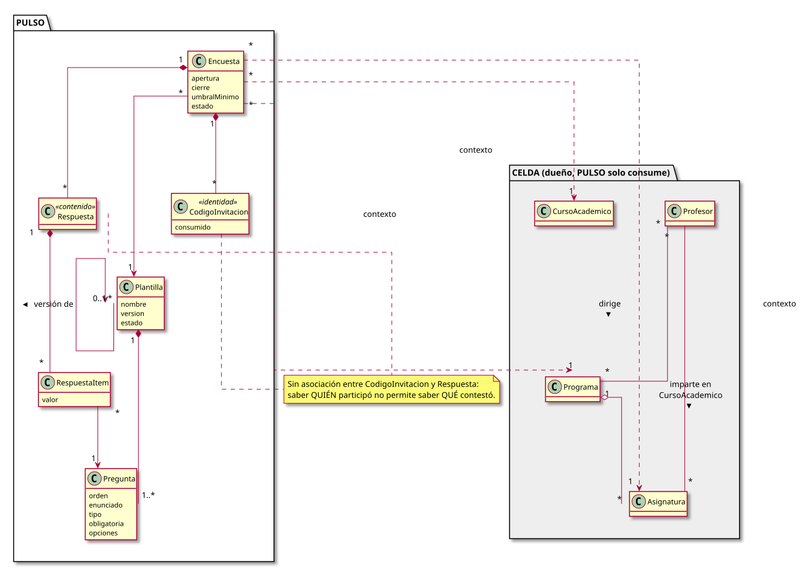
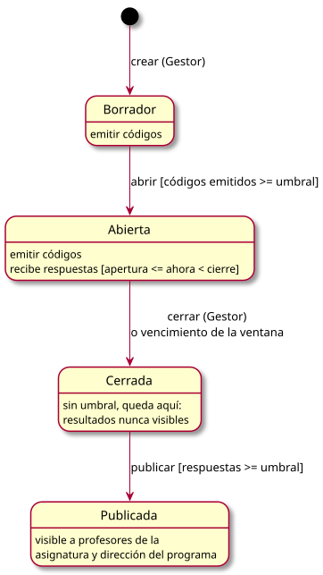
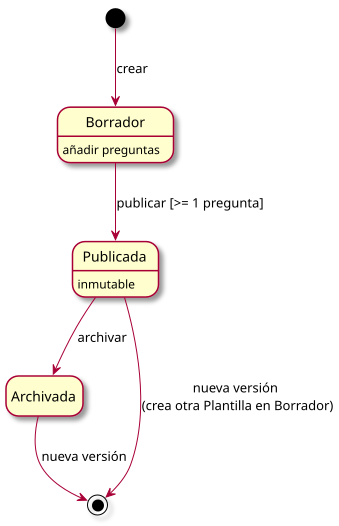

# Modelo del dominio

|
|-:
|[Código fuente](modeloDominio.puml)

| Concepto | Dueño | Descripción |
|---|---|---|
| Programa, Asignatura, CursoAcademico, Profesor | CELDA | PULSO los referencia por identificador y no los modifica |
| Plantilla | PULSO | Conjunto ordenado de preguntas. Publicada = inmutable; se versiona |
| Pregunta | PULSO | `likert5` (1-5), `likert7` (1-7), `opcion_unica` (lista de opciones) o `texto_libre`; sección opcional (las consecutivas con la misma sección forman un bloque) |
| Encuesta | PULSO | Plantilla aplicada a una asignatura de un programa en un curso académico, con ventana temporal y umbral |
| CodigoInvitacion | PULSO | Credencial de un solo uso. Lado identidad: solo dice si ya se usó |
| Respuesta, RespuestaItem | PULSO | Lado contenido: qué se contestó, sin vínculo con el código |

## Estados

| Encuesta | Plantilla |
|:-:|:-:|
|||
|[Código fuente](estados-entidades/encuesta.puml)|[Código fuente](estados-entidades/plantilla.puml)|
