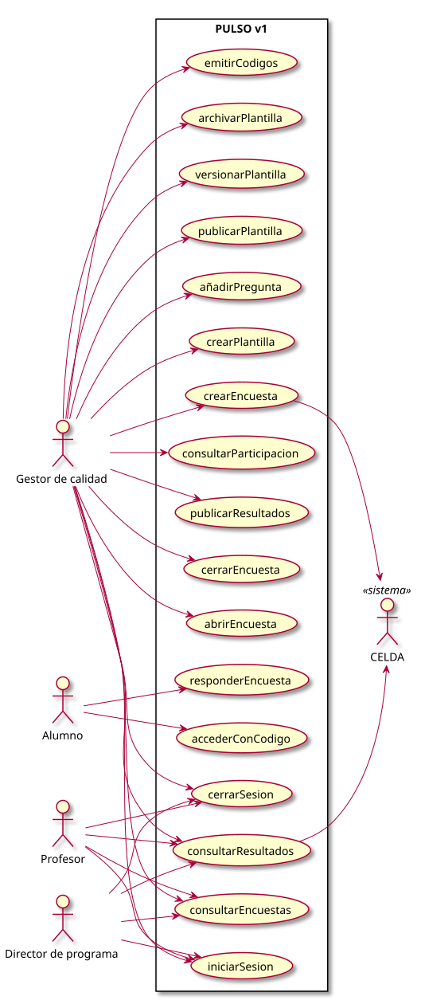

# Actores y casos de uso (v1)

|
|-:
|[Código fuente](actoresCasosUso.puml)

## Actores

| Actor | Identificación v1 | Ámbito |
|---|---|---|
| Gestor de calidad | Sesión con la cuenta de acceso (`ACCESO_USUARIO`) | Todo: plantillas, encuestas, códigos, ciclo de vida, participación y resultados sobre el umbral |
| Profesor | Imparte la asignatura en ese curso según CELDA | Resultados de encuestas **publicadas** de sus asignaturas |
| Director de programa | Dirige el programa según CELDA | Resultados de encuestas **publicadas** de su programa |
| Alumno | Ninguna: código de invitación | Responder una vez |
| CELDA | Sistema | Fuente del catálogo y de los roles de profesor y director |

## Casos de uso

| Caso de uso | Actor | Endpoint |
|---|---|---|
| iniciarSesion | Gestor (v1: una cuenta con contraseña); Profesor y Director pendientes de OAuth | `POST /api/auth/login` |
| cerrarSesion | Gestor (Profesor y Director cuando tengan login) | `POST /api/auth/logout` |
| crearPlantilla | Gestor | `POST /api/plantillas` |
| añadirPregunta | Gestor | `POST /api/plantillas/{id}/preguntas` |
| publicarPlantilla | Gestor | `POST /api/plantillas/{id}/publicar` |
| versionarPlantilla | Gestor | `POST /api/plantillas/{id}/nueva-version` |
| archivarPlantilla | Gestor | `POST /api/plantillas/{id}/archivar` |
| crearEncuesta | Gestor | `POST /api/encuestas` |
| emitirCodigos | Gestor | `POST /api/encuestas/{id}/codigos` |
| abrirEncuesta | Gestor | `POST /api/encuestas/{id}/abrir` |
| cerrarEncuesta | Gestor | `POST /api/encuestas/{id}/cerrar` |
| publicarResultados | Gestor | `POST /api/encuestas/{id}/publicar` |
| consultarParticipacion | Gestor | `GET /api/encuestas/{id}/participacion` |
| consultarEncuestas | Gestor, Profesor, Director | `GET /api/encuestas` |
| consultarResultados | Gestor, Profesor, Director | `GET /api/encuestas/{id}/resultados` |
| accederConCodigo | Alumno | `POST /api/participacion/acceder` |
| responderEncuesta | Alumno | `POST /api/participacion/enviar` |

Pendiente: detalle de casos de uso (especificación + wireframes) al estilo de `pyCelda/RUP/01-requisitos/03-detalle-casos-uso`.
