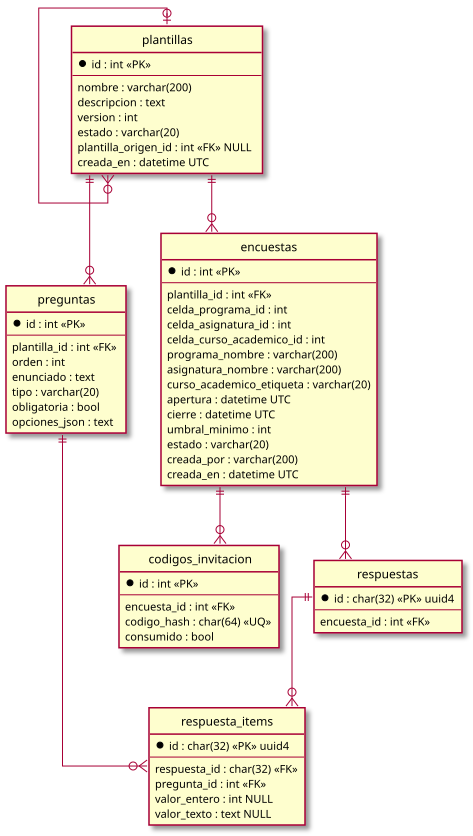

# Diseño

## Identidad visual

Identidad visual neutra, sin marca de ninguna institución: logotipo de texto "PULSO", azul pizarra `#2c4a6e` como color de marca, tipografías del sistema (sin Google Fonts ni otra dependencia externa), modo claro y oscuro. Adaptarla a una institución consiste en redefinir las variables de marca al principio de `frontend/src/estilos.css` (`--marca`, `--marca-oscuro`, `--marca-claro`, `--marca-fondo`, `--resalte`, `--oscuro`, `--sobre-marca`, y las fuentes `--fuente-texto` y `--fuente-titulos`), en el bloque claro y en el oscuro; el resto de la hoja solo usa variables. Un logotipo en imagen requiere además cambiar el enlace `.marca` de `frontend/src/Marco.tsx` y, si se sirve desde otro origen, `img-src` en la CSP.

## Navegación

| Ruta | Acceso | Contenido |
|---|---|---|
| `/` | Pública | Entrada: login del personal y acceso del alumno. Con sesión abierta redirige a `/app` |
| `/participar` | Pública | Participación con código |
| `/app` | Sesión | Encuestas visibles para el usuario |
| `/app/encuestas/:id` | Sesión | Participación (gestor) y resultados |
| `/app/plantillas`, `/app/encuestas/nueva` | Sesión + Gestor | Gestión |

## Arquitectura

| Capa | Tecnología | Ubicación |
|---|---|---|
| API | FastAPI + SQLAlchemy 2 + Pydantic 2, Python >= 3.11, `uv` | `backend/app` |
| Persistencia | SQLite (mismo criterio que pyCelda) | `DATABASE_URL` |
| Cliente | React 19 + TypeScript + Vite + react-router | `frontend/src` |
| Catálogo CELDA | Puerto `CatalogoCelda`; v1 `StubCatalogoCelda` sobre JSON | `backend/app/celda` |

Estructura del backend, misma división que pyCelda: `models/` (entidades y reglas propias de la entidad), `services/` (casos de uso, transacciones), `schemas/` (contratos de la API), `routers/` (HTTP y autorización), `core/` (configuración, base de datos, autenticación, límites).

## Integración con CELDA

CELDA no expone hoy una API para satélites. El stub (`StubCatalogoCelda`) lee un JSON indicado por `CELDA_STUB_PATH`; el del repositorio (`app/data/celda_stub.json`) es un catálogo de ejemplo ficticio: 5 programas, más los programas internos PAS y FACULTAD (ids fijos 9001 y 9002) y una asignatura `ENC ENCUESTA` por programa (id programa * 1000 + 999). Profesores y director son identidades ficticias de desarrollo. El catálogo de una institución sigue la misma estructura (`cursos_academicos`, `programas`, `asignaturas`, `imparticiones`) y las mismas reglas de ids (los tests de `tests/test_plantillas_institucionales.py` solo las comprueban sobre el fichero del repositorio; el de la institución se revisa a mano), y va fuera del repositorio para que `git pull` no lo sobrescriba. El puerto `CatalogoCelda` (`app/celda/catalogo.py`) define exactamente lo que PULSO necesita: programas, asignaturas, cursos académicos, `imparte(email, asignatura, curso)` y `dirige(email, programa)`. La implementación real sustituirá al stub sin cambios en servicios ni routers.

`Encuesta` guarda el identificador CELDA y una copia de la etiqueta legible (`*_nombre`, `curso_academico_etiqueta`): el dato sigue teniendo un único dueño, y el histórico de resultados sigue siendo legible si CELDA renombra o archiva.

## Autenticación

| Quién | v1 | Pendiente |
|---|---|---|
| Personal | Página de entrada con usuario y contraseña. Una cuenta, configurada por entorno (`ACCESO_USUARIO`, `ACCESO_CLAVE_HASH` en PBKDF2-SHA256, 600 000 iteraciones), con rol Gestor de calidad. Mismo error para usuario y contraseña incorrectos; 5 fallos / 15 min / IP. Sesión en cookie `pulso_sesion` firmada con HMAC-SHA256 (`SESSION_SECRET`), httpOnly, SameSite=Lax, Secure fuera de dev, 8 h | Google OAuth institucional como pyCelda (sustituye al endpoint de login, no a la cookie); cuentas para profesores y directores |
| Herramientas (tests, curl) | Cabecera `X-Dev-User`, solo en dev | Se mantiene solo en dev |
| Alumno | Código de invitación | v2: censo del ERP |

## Seguridad

| Control | Implementación |
|---|---|
| Fuerza bruta de códigos | 5 fallos / 15 min / IP -> 429 + `Retry-After` (`core/limites.py`). Solo cuentan fallos: un aula tras NAT comparte IP |
| Espacio de códigos | 10 caracteres de un alfabeto de 31 (~49 bits), `secrets` |
| Almacenamiento de códigos | HMAC-SHA256 con `CODIGO_PEPPER`; obligatorio fuera de dev (arranque falla sin él) |
| Tamaño de entrada | Límite de 256 KiB por `Content-Length`; límites de longitud en todos los esquemas Pydantic |
| Validación | Server-side completa de cada respuesta contra la plantilla |
| Cabeceras | `nosniff`, `X-Frame-Options: DENY`, `Referrer-Policy: no-referrer`, `Cache-Control: no-store`; CORS restringido a `FRONTEND_URL` |
| Documentación OpenAPI | Solo en dev |
| Secretos | `.env` ignorado; `.env.example` sin valores y con `PULSO_ENV=prod` |
| Orden de llegada | Respuestas reinsertadas en orden aleatorio al cerrar; `PRAGMA secure_delete = ON` en toda conexión SQLite |
| Cierre | Transición Abierta -> Cerrada con `UPDATE` condicional que toma el cerrojo de escritura antes de leer: dos cierres simultáneos no duplican respuestas; un envío concurrente re-comprueba el estado dentro de su escritura |
| Resultados en vivo | Ninguno hasta el cierre (ataque diferencial) |
| Login | 5 fallos / 15 min / IP (`limitador_login`); el intento se reserva antes de verificar el hash (ráfagas concurrentes no eluden el límite); mismo error y mismo coste para usuario y contraseña incorrectos; cookie httpOnly |
| Suplantación en dev | `X-Dev-User` nunca adopta la cuenta de acceso: esa identidad solo se obtiene con contraseña |
| CSRF | Cookie SameSite=Lax y rechazo de escrituras con `Sec-Fetch-Site` distinto de `same-origin` (cubre subdominios hermanos) |

Límites conocidos: la sesión no tiene estado en servidor (una cookie copiada vale hasta caducar, también tras cambiar la contraseña; solo rotar `SESSION_SECRET` las invalida); el limitador vive en memoria de un proceso (con varios workers hay que moverlo a almacén compartido) y es por IP, sin límite por cuenta; el límite de tamaño no cubre peticiones `chunked` sin `Content-Length` (lo cubre Caddy); CSP y HSTS los pone Caddy (configuración en el [despliegue](../../docs/DESPLIEGUE.md#etccaddycaddyfile)).

## Configuración

Variables en [`backend/.env.example`](../../backend/.env.example):

| Variable | Uso |
|---|---|
| `PULSO_ENV` | `dev` habilita `X-Dev-User` y `/api/docs`. Ausente = producción |
| `DATABASE_URL` | URL SQLAlchemy |
| `CODIGO_PEPPER` | Secreto HMAC de los códigos. Cambiarlo invalida todos los códigos emitidos |
| `ACCESO_USUARIO`, `ACCESO_CLAVE_HASH` | Cuenta de acceso. El hash se genera con `python3 -m app.core.claves`; la contraseña no se guarda en ningún fichero |
| `SESSION_SECRET` | Firma de la cookie de sesión; obligatorio (>= 32 caracteres) fuera de dev. Cambiarlo cierra todas las sesiones |
| `GESTORES_EMAILS` | Emails con rol Gestor de calidad, separados por comas. Solo tiene efecto a través de `X-Dev-User` en dev; las sesiones solo se emiten para `ACCESO_USUARIO` |
| `FRONTEND_URL` | Origen permitido por CORS |
| `CELDA_STUB_PATH` | JSON del catálogo simulado. Por defecto, el catálogo de ejemplo del repositorio; los tests usan `tests/celda_test.json` |

## Modelo de datos

|
|-:
|[Código fuente](modelo-datos/DER.puml)

Sin migraciones completas en v1: `create_all` al arrancar y, para columnas nuevas anulables sobre una base existente, `python -m app.cargar_plantillas --migrar` (`ALTER TABLE ADD COLUMN`). Cambios de mayor calado con datos reales requieren Alembic.
